<picture>
  <source media="(prefers-color-scheme: dark)" srcset="https://raw.githubusercontent.com/iqubik/routerFW/output/release-timeline-dark.svg">
  <source media="(prefers-color-scheme: light)" srcset="https://raw.githubusercontent.com/iqubik/routerFW/output/release-timeline.svg">
  
</picture>

# Language / Язык
[🇷🇺 Русский язык](README.md) | [🇺🇸 English]

# 🚀 OpenWrtFW Builder v4.71+ (Image + Source) + IPK/APK Injection

Many have likely wanted to have a personal OpenWrt router binary with a full configuration and custom packages. Not just a backup, but a direct version rollback to a clean `.bin` file!

This project has now evolved into a **Universal All-in-One Tool**, combining two approaches: fast assembly (**ImageBuilder**) and full compilation (**SourceBuilder**).

In version 3.0+, a **global refactoring** took place: the old `_Image_Builder.bat` and `_Source_Builder.bat` scripts were removed and replaced by a single `_Builder` that manages both modes.

---

## 📥 Installation and Download

The entire project is contained in **one self-extracting file**, `_unpacker`. You don't need to download ZIP archives or clone the repository.

*   **Preparation:** Install a supported container runtime: `Docker` or `Podman`. By default the builder uses `ROUTERFW_RUNTIME=auto`.

## 🌍 International Unpacker
The project is deployed via a **unified international unpacker** `_unpacker`. All system messages during deployment have been translated into English to ensure clarity for global users.

### Choose your download method:
*   🔥 **[Download _unpacker.bat (Latest version)](https://github.com/iqubik/routerFW/raw/main/_unpacker.bat)** — The most up-to-date Windows code.
*   🔥 **[Download _unpacker.sh (Latest version)](https://github.com/iqubik/routerFW/raw/main/_unpacker.sh)** — The most up-to-date Linux code.
*   📦 **[Releases Section](https://github.com/iqubik/routerFW/releases)** — Verified versions with changelogs.

> **How to run:**
> 1. Place `_unpacker` in an **empty folder** (e.g., `C:\OpenWrtBuilder`) with no Cyrillic characters in the path.
> 2. Run it — it will deploy the project structure.
> 3. Run the resulting `_Builder`.
> 4. If needed, pin the runtime with `--runtime=docker`, `--runtime=podman`, or the `ROUTERFW_RUNTIME` environment variable.

## 🖥 Interface

> **Appearance: Main Window**


> **Appearance: Multiple build**


---

### 📊 Profile Indicator System
The main menu features a "surgical" resource panel **`[F P S M H X | OI OS]`** for instant profile assessment:
*   **F (Files)** — File overlay detected (`custom_files`).
*   **P (Packages)** — External `.ipk` packages present.
*   **S (Source)** — Package source code found (`src_packages`).
*   **M (Manual Config)** — Active Menuconfig diff file detected.
*   **H (Hooks)** — Automation script `hooks.sh` detected.
*   **X (Patches)** — Source code patches detected (`custom_patches/<profile>`).
*   **OI / OS** — Ready firmware present (Image / Source Builder).

---

### 🛡️ APK Scanner (v4.70+)
Built-in scanner for automatic validation and renaming of `.apk` files before building in Image Builder mode.

*   **Why:** Image Builder rejects packages if the filename doesn't match the internal version (the `luci-i18n-podkop-ru` bug). The scanner uses the selected Docker or Podman runtime (`apk adbdump`) and offers to correct filenames using package metadata.
*   **noarch/all:** Packages with universal architecture (scripts, LuCI, configs) are now correctly passed for any device.
*   **Auto-launch:** Runs before the selected Compose runtime starts in IB mode when `.apk` files are present in `custom_packages/`.
*   **Manual launch:** **`[S] APK Scanner`** button in the main menu — profile selection, scan, report.

👉 **[Lesson 8: Embedding APK/IPK in Image Builder](docs/08-ib-apk-import-embed.en.md)** — step-by-step guide, real-world issues, and FAQ.

---

## ⌨️ Command-Line Interface (CLI)

You can run the builder with arguments **without entering the interactive menu** (Windows: `_Builder.bat`, Linux: `_Builder.sh`).

### Interface language
*   **`--lang=RU`** / **`--lang=EN`** or **`-l RU`** / **`-l EN`** — force interface language (any position on the command line). Without the key — auto-detection from the system.

### Trusted profile and package model
*   `profiles/*.conf` files are treated as **trusted input**: the builder consumes values from the profile and related shell-side resources. Do not run third-party `.conf`, `hooks.sh`, patches, or packages without reviewing them first.
*   If you enable external repositories and signing keys via `CUSTOM_REPOS` / `CUSTOM_KEYS`, you are explicitly trusting those sources.
*   The current Image Builder make invocation disables APK signature checking to allow local unsigned packages. This also disables signature verification for network APKs in that build invocation. APK Scanner validates metadata and filenames; it does not establish cryptographic package authenticity. Use only trusted repositories and packages.

### Build mode (Image Builder / Source)
*   **Prefix before command:** `ib` or `image` — Image Builder, `src` or `source` — Source Builder. Without a prefix, **Image Builder** is used by default.
*   **Build profile 1 in IB:** `_Builder.bat build 1` or `_Builder.bat ib build 1`
*   **Build profile 1 in Source:** `_Builder.bat src build 1`
*   **Build all:** supported only for Image Builder: `_Builder.bat ib build-all`. Source Builder `build-all` is intentionally rejected.

### Main commands

| Command | Short | Arguments | Action |
|--------|--------|-----------|--------|
| `build` | `b` | profile number or name | Build one profile |
| `build-all` | `a`, `all` | — | Build all Image Builder profiles; Bash runs in parallel, Windows runs sequentially |
| `edit` | `e` | [id] | Profile editor |
| `menuconfig` | `k` | \<id\> | Menuconfig (Source only) |
| `import` | `i` | \<id\> | Import IPK (Source only) |
| `wizard` | `w` | — | Profile creation wizard |
| `clean` | `c` | [type] [target] | Clean (type 1–6 SRC / 1–3 IMG); global prune item 9 is disabled |
| `state` | `s` | — | Profile table with flags (F,P,S,M,H,X,OI,OS) |
| `check` | — | `<id>` | Add/update checksum in profiles/ID.conf |
| `check-all` | — | — | Add/update checksum:MD5 in all unpacker files |
| `check-clear` | — | `[<id>]` | Clear checksum:MD5 from all files or one profile |
| `help` | `-h`, `--help` | — | Help and exit |

**Positional:** `_Builder.bat 2` = build profile #2 (default mode — IB). Commands are case-insensitive.

**Examples:** `_Builder.bat --lang=EN build 1`, `_Builder.bat ib build-all`, `_Builder.bat clean 2 3`, `_Builder.bat --help`. `src build-all` is not supported.

For more details, see [Architecture diagrams — Command-line section](docs/ARCHITECTURE_diagram_en.md#command-line-interface-windows).

---

## 📖 Documentation and Training

An extended knowledge base has been created for the project to help you go from beginner to pro.

👉 **[OPEN FULL GUIDE (DOCS EN)](docs/index.en.md)**

**Inside you will find:**
*   **Lessons 1–5:** Basics, configuration, Source Build, patches, and advanced customization.
*   **Lesson 6:** Flashing RAX3000M eMMC (manual GPT, bootenv, overlay troubleshooting).
*   **Lesson 7 (FAQ):** Troubleshooting and limitations (zapret/nfqws, device tips).
*   **Lesson 8:** Embedding APK/IPK in Image Builder (auto-scanner, noarch/all, filename validation).
*   **[Project Architecture & Diagrams](docs/ARCHITECTURE_en.md)** — full flowcharts of all builder processes.

Ready-made images for specific devices: see the 4pda discussion and [Releases](https://github.com/iqubik/routerFW/releases).

---

## ⚡ About the Project

Builds run in isolated **Docker or Podman containers**. Work data and caches live in persistent named volumes, so deleting the project folder does not remove those volumes. Use the profile-scoped `[C] CLEAN` wizard to remove project data; global prune is disabled.

### Two operating modes:

#### 1. 🐇 Image Builder (Fast)
*   **Speed:** depends on the profile and cache state; see the RAX3000M baseline test measurements below.
*   **Purpose:** Add packages (`luci`, `vpn`), embed Wi-Fi/PPPoE configs.
*   **Features:** **Atomic Downloads** (protection against network failures), smart caching, integration of third-party `.ipk` files (from the `custom_packages` folder), **APK Scanner** (automatic validation and renaming of packages before build).

#### 2. 🐢 Source Builder (Powerful)
*   **Speed:** depends on the profile and **CCache** state; see the RAX3000M baseline test measurements below.
*   **Purpose:** 16MB mods, kernel patches, compiling programs from source.
*   **Features:**
    *   **Vermagic Hack:** attempts to align vermagic with the official repository and can improve compatibility with matching `kmod-*` packages. It cannot guarantee compatibility with every kernel, configuration, or ABI.
    *   **Persistence:** Isolated folders and caches for each profile.
    *   **Binary-to-Source Import:** Allows embedding ready-made `.ipk` packages (even without source code) directly into firmware compiled from source.
    *   Support for any Git branches and forks (ImmortalWrt, Padavan).

### RAX3000M baseline test profile measurements (four builds total)

Each row lists the first build and its repeat; the shell sequence is BAT → SH or SH → BAT. Results depend on the profile, environment, and cache state.

| Build | First | Repeat |
| --- | ---: | ---: |
| IB: BAT → SH | 281 s | 50 s |
| SB: SH → BAT | 2563 s | 182 s |

---

### 📦 Local Image Builder and Profile Update (v4.40+)

You can now build firmware **from your own** Image Builder image without downloading it from the internet each time.

*   **Local path in profile:** Instead of a URL in `IMAGEBUILDER_URL`, you can set a path to an archive on disk (e.g. one you just built in Source mode). The builder will use the image from the `firmware_output` folder — no download required.
*   **Offer to update profile:** After a successful source build (**Source Builder** mode), the program looks in the output folder for the new Image Builder file (`.tar.zst`) and offers to write its path into your `.conf`. Accept once — the next run will use that local image by default.

> **💡 Workflow:** Build firmware from source → get your Image Builder in the output folder → on the next run the program offers to add it to the profile → subsequent fast (Image Builder) builds use your local image.

---

## 🧹 Maintenance Mode (Cleaning System)

The **[C] CLEAN** button invokes the granular cleaning wizard:

| Option | Description | When to use? |
| :--- | :--- | :--- |
| **Soft Clean** | Runs `make clean`. | If there are package linking errors. |
| **Hard Reset** | Deletes `src-workdir`, keeping `dl`. | If the Toolchain or Git tree is broken. |
| **Clean DL** | Deletes the source code archive. | To free up disk space. |
| **Clean Ccache** | Resets the compiler cache. | When changing architecture or GCC version. |
| **Clean tmp (Package Index)** | Clears package index cache. | Fixes "stuck" package versions. |
| **Factory Reset** | Deletes **EVERYTHING** for the profile. | Complete reset to "factory" state. |

---

### 🧙 Profile Wizard

Forgot your router's architecture or afraid of syntax errors? Use the **[W] Profile Wizard** menu item.

*   **Step-by-step selection**: Release, platform, and router model are selected from lists.
*   **Smart settings**: Just press **Enter** to select standard values (LuCI, system names).
*   **Validation**: The wizard automatically fixes spaces in names and protects files from accidental overwriting.
*   **Ready-made result**: Output is a clean `.conf` file with useful comments and optimization examples.


---

## 📂 Folder Structure

*   `docs/` — Offline copy of the knowledge base.
*   `profiles/` — Your universal `.conf` files.
*   `custom_files/profile_name/` — File overlay (everything here goes to the router's root).
*   `custom_packages/profile_name/` — Folder for `.ipk/apk` packages. Used in **ImageBuilder** (direct inclusion, auto-scanner validation) and as a source for import in **SourceBuilder**.
*   `src_packages/profile_name/` — For source code. Used for third-party packages from GitHub and as the **output folder** for `.ipk` files processed by the importer.
*   `firmware_output/` — Ready firmwares and build logs.
*   `system/` — Builder engines, Dockerfiles, Docker/Podman Compose files, scripts, localization, and version metadata.

---

## ⚙️ Source Code Patching System (v4.3+)

This feature allows you to directly modify the OpenWrt source code before compilation. It works on a **"mirror overlay"** principle. Any file you place in the `custom_patches/<PROFILE_ID>/` directory will overwrite the original file, preserving the path structure. This is perfect for replacing `Makefiles` and, most importantly, for applying `.patch` files **natively**. The build system automatically picks up patches for the kernel or packages if they are placed in the correct directory, **eliminating the need for `hooks.sh` in most cases**.

> **Persistent-worktree limitation:** the overlay is currently copied with `rsync -a` (without `--delete`). If you remove a file from `custom_patches`, a previously copied untracked file may remain in the worktree. Removing it from the overlay alone does not guarantee rollback; use the profile-scoped `src-workdir` cleanup when a reset is required.

The system **automatically converts Windows line endings (CRLF)** to Unix (LF), so you can edit files in any text editor without worrying about breaking the build.

👉 Learn more in the [Advanced Guide to Source Patching](docs/05-patch-sys.en.md).

---

## ⚙️ Universal Profiles (.conf)

You don't need to configure each build mode separately. The system uses a **single configuration file** to manage the entire process:

*   **One program list**: Manage all packages (VPN, AdGuard, Luci) in a single line for both modes.
*   **Flexible management**: Router model, number of CPU cores for building, and partition sizes are all set in one place.
*   **Order**: One file — one device. Easy to edit, easy to share.

👉 Read a detailed breakdown of the profile structure and step-by-step creation of the "ideal recipe" in **[Lesson #2: Digital Twin of Your Router](docs/02-digital-twin.md)**.

---

## 🎛️ Resource Management (SRC_CORES Source Builder)

CPU load settings in the profile file (`.conf`):

*   **`SRC_CORES="safe"`** — uses all cores minus one ($N-1$). The system remains responsive.
*   **Not set (default)** — uses all available cores ($N$). Maximum speed.
*   **`SRC_CORES="4"`** — a fixed number of build threads.
*   **`SRC_CORES="debug"`** — forces a single-threaded build with full verbosity (`make -j1 V=s`), ideal for troubleshooting.

```bash
# Example: leave one core free
SRC_CORES="safe"
```

---

## 🪝 Smart Hooks and Vermagic Hack

The package includes the `scripts/hooks.sh` template. To enable it for a profile, copy it to `custom_files/your_profile/hooks.sh`. Source Builder runs it before `make defconfig`; it can modify the source tree.

> **Stage ordering:** Source Builder first copies the managed `custom_files` overlay into `files/` **without `--delete`**, then runs hooks and tracks their newly created files. There is no destructive sync after hooks. Upstream OpenWrt, not routerFW device lists, determines images and bootloaders.

1.  **Auto-Enable Wi-Fi on First Boot:** the template can create a `uci-defaults` script that enables detected wireless radios on first boot. Verify that it is appropriate for your device and final overlay.
2.  **Git-Safe Patching:** Safely modifies source code before building. Allows changing DTS and Makefiles (e.g., for 16MB mods). Automatic backups protect selected modifications.
3.  **Vermagic Hack (Repository Compatibility):**
    *   *The Problem:* Normally, when you build your own kernel (SourceBuilder), its "fingerprint" (vermagic) differs from the official one. This prevents you from installing `kmod-*` (driver) packages from the official repository.
    *   *The Solution:* the script attempts to retrieve the official manifest for the selected OpenWrt version and apply the matching hash to the build logic.
    *   *Result:* this can improve compatibility with matching official kernel modules, but it is not a guarantee across different kernels, configurations, or ABIs.

### 🛡️ Reliability Architecture (v4.09+)

Starting with version 4.09, the builder's architecture has been significantly redesigned with a focus on predictability and stability.

*   **Supported Vermagic rollback (Source Builder):** when `hooks.sh` is absent, the builder checks specific markers and the backup for `include/kernel-defaults.mk`. If the supported modified state is detected, it restores the backup, cleans related kernel build directories, and resets CCache. This is not a universal rollback of arbitrary files left by custom hooks or overlays.

*   **Container storage on WSL/Linux:** persistent volumes and WSL/Docker/Podman virtual disks depend on healthy storage and sufficient free space. `EROFS`, `EIO`, or a full disk cannot be repaired by retrying `make`; inspect the runtime, volume, filesystem, and host disk first.

---

## 🎛️ Interactive Configuration (Menuconfig)

Version 3.3 introduced the ability to fine-tune the kernel and packages via the standard OpenWrt graphical menu (`make menuconfig`). This is only available in **Source Builder** mode.

### How it works:

1.  **Launch menu:** In the main menu, select `[K] MENUCONFIG`.
2.  **Configuration:** If this is the first run, after preparation, the classic blue Linux Kernel Configuration interface will open. Select the required kernel modules, drivers, or packages.
3.  **Saving:** Press `<Save>` (keep the name `.config`) and then `<Exit>`.
4.  **Result:** The script will capture the config and save it as a **master file** in the folder:
    `firmware_output/sourcebuilder/<profile_name>/manual_config`


### ⚠️ Configuration Priority (Manual Config)

The build system now automatically determines the configuration strategy:

*   **Automatic Mode (Default):** If the `manual_config` file is not present in the firmware output folder, the builder generates `.config` on the fly using variables from your profile (`SRC_PACKAGES`, `SRC_EXTRA_CONFIG`, `COMMON_LIST`).
*   **Manual Mode (Priority):** If the `manual_config` file is found in the output folder, the builder **IGNORES** the package lists and kernel options from the `.conf` file. Instead, it applies your saved config "as is" (adding only caching settings).

> **How to return to auto-build?** Simply delete or rename the `manual_config` file in the `firmware_output` folder.

## 🎛️ Interactive Tuning & Sync (v4.03)
In **Source Builder** mode (`[K] MENUCONFIG`), a **full synchronization cycle** is now implemented:
1.  **Modify:** Change settings in the standard OpenWrt GUI.
2.  **Sync:** Upon exit, the script offers to transfer changes **directly into your profile file (`.conf`)**.
3.  **Clean Syntax:** Parameters are saved in `SRC_EXTRA_CONFIG` using a multi-line format, supporting `# ... is not set` comments and eliminating parsing errors.
4.  **History:** Original diffs are archived with timestamps (`applied_config_*.bak`).

---

### ⚡ Source Builder Quick Start (Cold Start)

If you are using specific repositories with their own set of drivers (e.g., for MT798x), use the **manual_config** strategy:

1. **Initialization**: Configure `SRC_REPO` and run **[K] Menuconfig** so the system creates the folder structure.
2. **Replacement**: Take a minimal `defconfig` from the source author (~15 KB), rename it to `manual_config`, and place it in the profile output folder.
3. **Deployment**: Run **[K] Menuconfig** again — the system will resolve dependencies and expand the file to a full `.config` (~400 KB).

👉 Detailed instructions for deep configuration and working with custom kernels: **[docs/04-adv-source-build.md](docs/04-adv-source-build.md)**.

---

### ⚙️ Automatic `.ipk` Package Import (Binary-to-Source)

This is one of the **key features** of `Source Builder` v3.8+, solving a difficult problem: how to embed a ready-made `.ipk` package into the firmware for which you **do not have the source code**.

**The Problem:**
Normally, adding a package to a `Source` build requires writing a complex `Makefile`. If you only have a binary `.ipk` (e.g., a closed-source driver or an old program), integrating it becomes a nightmare: you have to manually unpack archives, define paths, fix permissions, and hope the build system doesn't corrupt the files.

**The Solution in Builder — Full Automation:**
Instead of manual work, you simply use the built-in importer:

1.  **Place the `.ipk`** in the `custom_packages/your_profile_name/` folder.
2.  **Select `[I] Import IPK`** in the main menu.
3.  **Done!**

The script will do all the dirty work:
*   **Create a Makefile wrapper:** You no longer need to write them manually.
*   **Preserve symlinks and permissions:** Unpacking happens inside a Linux container, solving filesystem issues.
*   **Protect binaries:** It disables `strip` and `patchelf` so the build system doesn't touch your files.
*   **Check architecture:** Warns if you try to import a `mips` package into an `aarch64` build.
*   **Integrate into Menuconfig:** After import, the package will appear in `menuconfig` under the `Custom-Packages` category, ready to be included in the firmware.

This feature turns closed-source software integration from a complex engineering task into a three-step process.

---

## 🛠 FAQ: Useful Tips and Troubleshooting

### ❓ ImageBuilder or SourceBuilder? Which to choose?
> **Choice depends on your goals:**
> *   **ImageBuilder:** (1–3 minutes). Ideal if you just need to add LuCI, VPN, configure Wi-Fi, or change the package set.
> *   **SourceBuilder:** (20–60+ minutes). Necessary for deep modding: creating firmware for 4MB flash drives (compression), changing kernel settings, integrating specific drivers, or creating firmware with non-standard partition sizes (e.g., 16MB mod).

### ❓ Is parallel building of multiple profiles safe?
> **Yes, completely.** Image Builder coordinates shared downloads/cache access and supports bounded concurrency.
> *   If several Image Builder profiles need the same SDK, cache coordination is intended to avoid redundant concurrent downloads.
> *   Other builds can reuse the completed cache. This reduces races but does not eliminate failures caused by storage, filesystem, memory, or runtime problems.

### ❓ What to do in case of network errors (wget error 4)?
> The system is adapted for unstable communication channels thanks to **Smart Retries**:
> *   An aggressive `wgetrc` is configured inside the containers (5 attempts for each file).
> *   `ib_builder.sh` retries each `wget` request (up to 5 attempts) and runs `make image` at most twice. Source Builder retries `make download` with verbose output; after a failed parallel compile it makes one `make -j1 V=s` attempt. There are no three automatic full-build restarts.

---

### 🔍 Quick Solutions (Troubleshooting)

*   **Error `Package not found`?**
    *   Ensure you placed the required `.ipk` files in the `custom_packages` folder or check the package name spelling in your `.conf` file.
*   **How to check if Vermagic Hack is working?**
    *   After flashing the router, try installing any kernel module from the official repository, for example: `opkg update && opkg install kmod-fs-btrfs`. If the installation proceeds without an *Exec format error*, the hack is active.
*   **Dependency conflict (e.g., dnsmasq)?**
    *   When installing extended versions of packages (full/crypto), always remove the base version first.
    *   *Example in config:* `-dnsmasq dnsmasq-full`.
*   **Error `The system cannot find the drive specified`?**
    *   Usually occurs if the project path contains special characters or spaces. It is recommended to place the project folder closer to the root of the drive (e.g., `C:\OpenWrt_Build\`).

---

## 🔧 Utility Scripts (`/scripts`)

*   `hooks.sh` — Template for patches and Vermagic.
*   `diag.sh` — Creates a report for router diagnostics via AI.
*   `upgrade.sh` — Bulk update of all packages on the router.
*   `packager.sh` — Generates a clean list of only user-installed packages.
*   `show_pkgs.sh` — Alternative way to get a package list from the lessons.
*   `scripts/etc/uci-defaults/99-permissions.sh` — fixes permissions for selected files (Dropbear/SSH).

<picture>
  <source media="(prefers-color-scheme: dark)" srcset="https://raw.githubusercontent.com/iqubik/routerFW/output/release-tree-dark.svg">
  <source media="(prefers-color-scheme: light)" srcset="https://raw.githubusercontent.com/iqubik/routerFW/output/release-tree.svg">
  
</picture>

Git activity graph:

<picture>
  <source media="(prefers-color-scheme: dark)" srcset="https://raw.githubusercontent.com/iqubik/routerFW/output/github-contribution-grid-snake-dark.svg">
  <source media="(prefers-color-scheme: light)" srcset="https://raw.githubusercontent.com/iqubik/routerFW/output/github-contribution-grid-snake.svg">
  
</picture>

Release visualization (CHANGELOG) — timeline, heatmap, activity river, pulse bars, stats:

<picture>
  <source media="(prefers-color-scheme: dark)" srcset="https://raw.githubusercontent.com/iqubik/routerFW/output/release-river-v3-dark.svg">
  <source media="(prefers-color-scheme: light)" srcset="https://raw.githubusercontent.com/iqubik/routerFW/output/release-river-v3.svg">
  
</picture>

<picture>
  <source media="(prefers-color-scheme: dark)" srcset="https://raw.githubusercontent.com/iqubik/routerFW/output/release-bars-v3-dark.svg">
  <source media="(prefers-color-scheme: light)" srcset="https://raw.githubusercontent.com/iqubik/routerFW/output/release-bars-v3.svg">
  
</picture>

<picture>
  <source media="(prefers-color-scheme: dark)" srcset="https://raw.githubusercontent.com/iqubik/routerFW/output/release-stats-v3-dark.svg">
  <source media="(prefers-color-scheme: light)" srcset="https://raw.githubusercontent.com/iqubik/routerFW/output/release-stats-v3.svg">
  
</picture>

<picture>
  <source media="(prefers-color-scheme: dark)" srcset="https://raw.githubusercontent.com/iqubik/routerFW/output/release-heatmap-v3-dark.svg">
  <source media="(prefers-color-scheme: light)" srcset="https://raw.githubusercontent.com/iqubik/routerFW/output/release-heatmap-v3.svg">
  
</picture>

---

Project audit https://github.com/iqubik/routerFW/blob/main/docs/audit.md
# checksum:MD5=08678b29c95e93d584f27df743a0f5d6