# file: docs\index.md

  <b>🇷🇺 Русский</b> | <a href="index.en.md"><b>🇺🇸 English</b></a>

---

# Уроки по Универсальному Билдеру OpenWrt

Здесь собрана серия уроков, которая поможет вам освоить Универсальный Билдер от азов до продвинутых техник.

## Оглавление

1.  [**Урок 1: Знакомство с Билдером**](./01-introduction.md)
    *   *Что это за инструмент, какие проблемы он решает и каковы его ключевые преимущества.*

2.  [**Урок 2: Цифровой двойник ваших настроек**](./02-digital-twin.md)
    *   *Практическое руководство по созданию воспроизводимой копии конфигурации роутера в виде профиля и прошивки.*

3.  [**Урок 3: Сборка из исходников: Максимальный контроль**](./03-source-build.md)
    *   *Освоение `Source Builder` на реальном примере: использование `defconfig` и `menuconfig` для сложных сборок.*

4.  [**Урок 4: Продвинутый Source-режим: патчи, хаки и свои пакеты**](./04-adv-source-build.md)
    *   *Работа с `vermagic`, применение патчей, добавление сторонних пакетов из исходников и управление фидами.*

5.  [**Урок 5: Продвинутый: Система патчей исходного кода**](./05-patch-sys.md)
    *   *Кастомизация сборок путем прямого изменения исходного кода OpenWrt с помощью системы "зеркального оверлея".*

6.  [**Урок 6: Установка прошивки на RAX3000M eMMC**](./06-rax3000m-emmc-flash.md)
    *   *Ручная разметка GPT, bootenv, запись разделов по SSH, решение проблем overlay и U-Boot.*

7.  [**Решение проблем и FAQ**](./07-troubleshooting-faq.md)
    *   *Ограничения сборок (zapret/nfqws), советы по устройству, ссылки на смежные уроки.*

8.  [**Урок 8: Встраивание APK/IPK в Image Builder**](./08-ib-apk-import-embed.md)
    *   *Добавление кастомных пакетов в IB-режим, автоматическая валидация имён APK, работа с архитектурами noarch/all и APK Scanner.*

## Архитектура проекта

<picture>
  <source media="(prefers-color-scheme: dark)" srcset="https://raw.githubusercontent.com/iqubik/routerFW/output/architecture-tetris-dark.svg">
  <source media="(prefers-color-scheme: light)" srcset="https://raw.githubusercontent.com/iqubik/routerFW/output/architecture-tetris.svg">
  
</picture>

*   [**Архитектура и поток процессов**](./ARCHITECTURE_ru.md) — текстовые схемы всех этапов сборки.
*   [**Диаграммы Mermaid**](./ARCHITECTURE_diagram_ru.md) — блок-схемы: запуск, меню, сборка, очистка и Menuconfig.
*   [**Карта развития проекта**](./map.md) — эпохи и версии по CHANGELOG, визуализация роста.

---

[**Аудит проекта**](audit.md#аудит-проекта-routerfw) — состояние репо, конвенции, риски.
# checksum:MD5=7ccc5f020161829907969159dc06151d